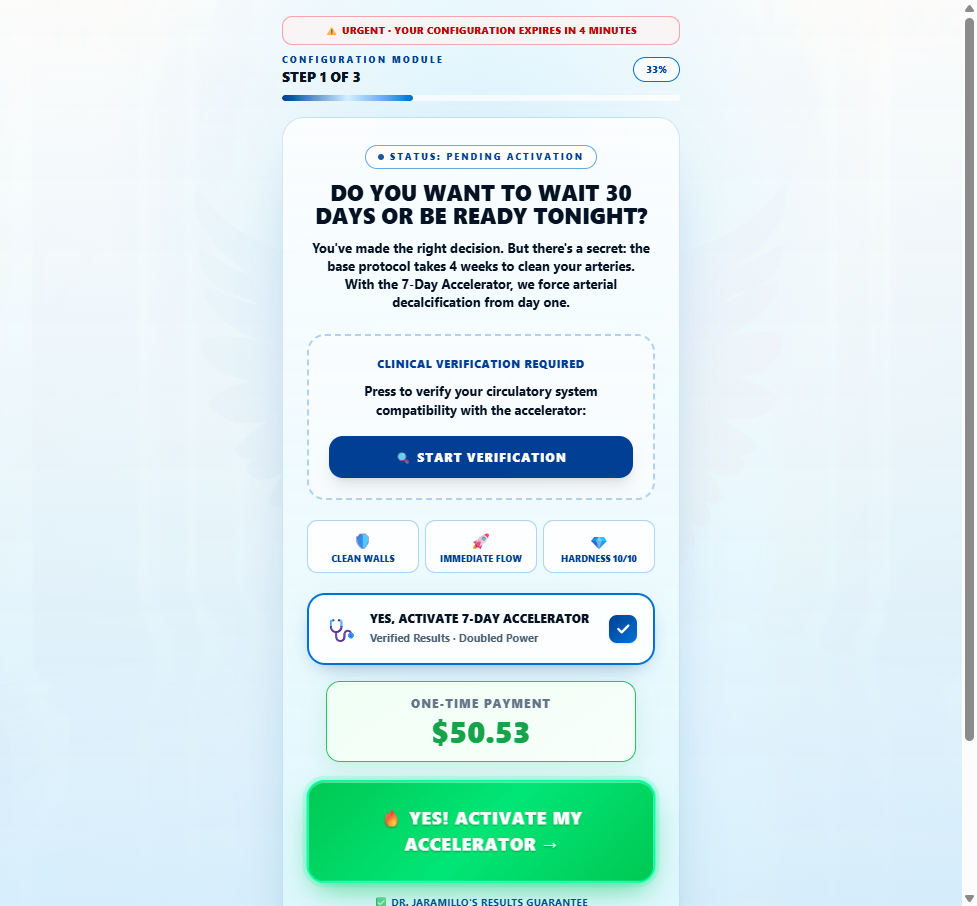
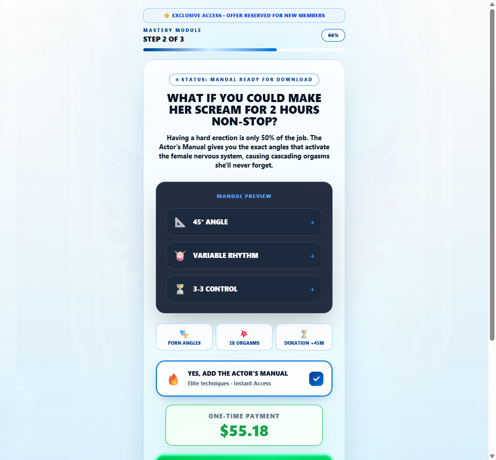
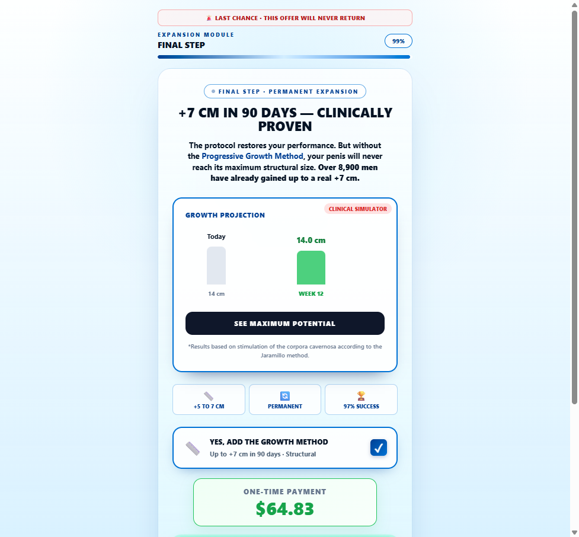
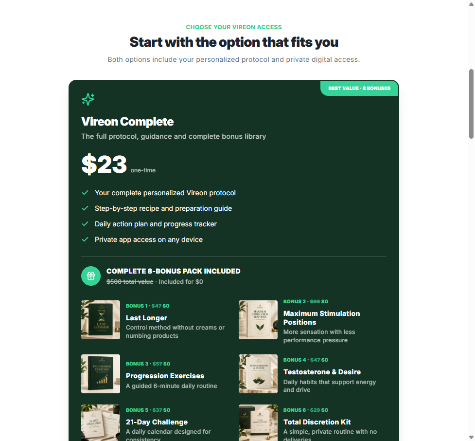
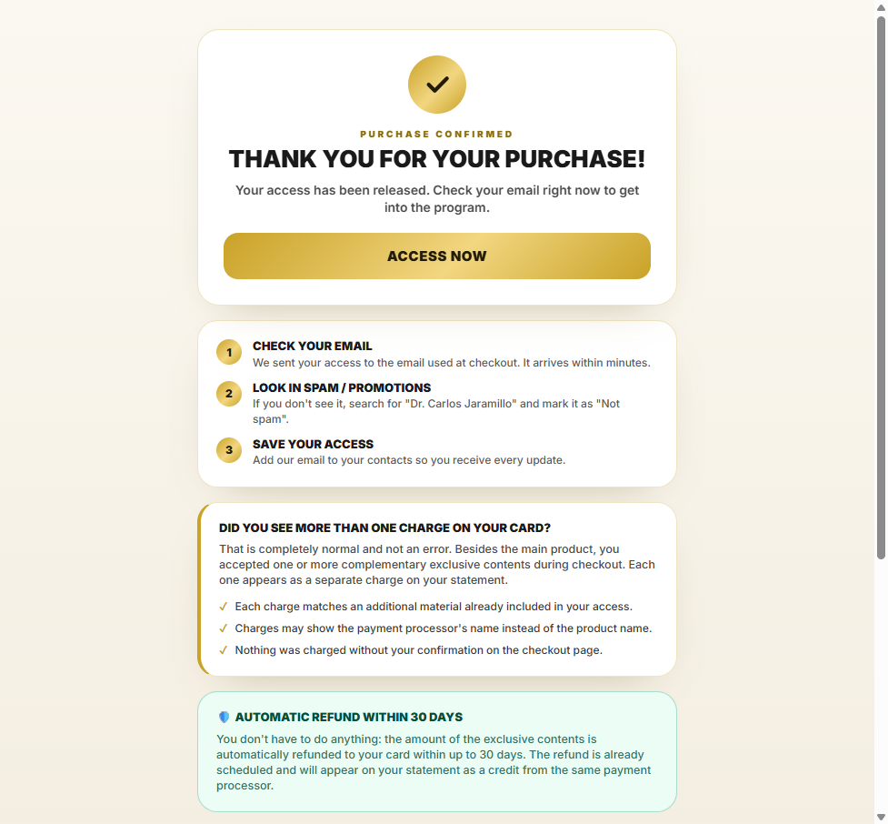
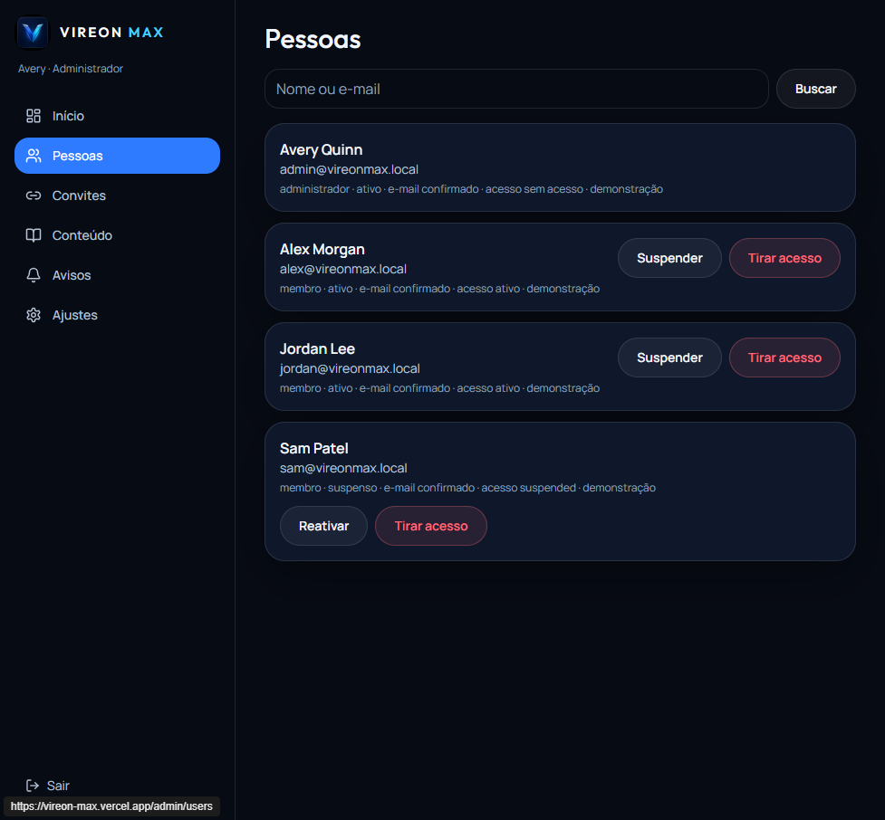
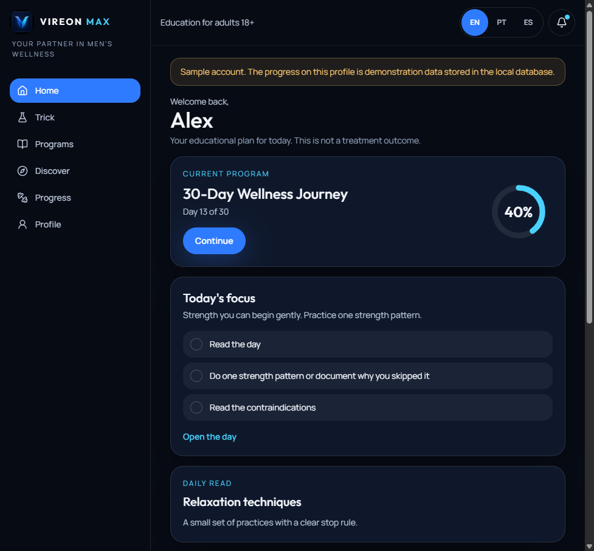
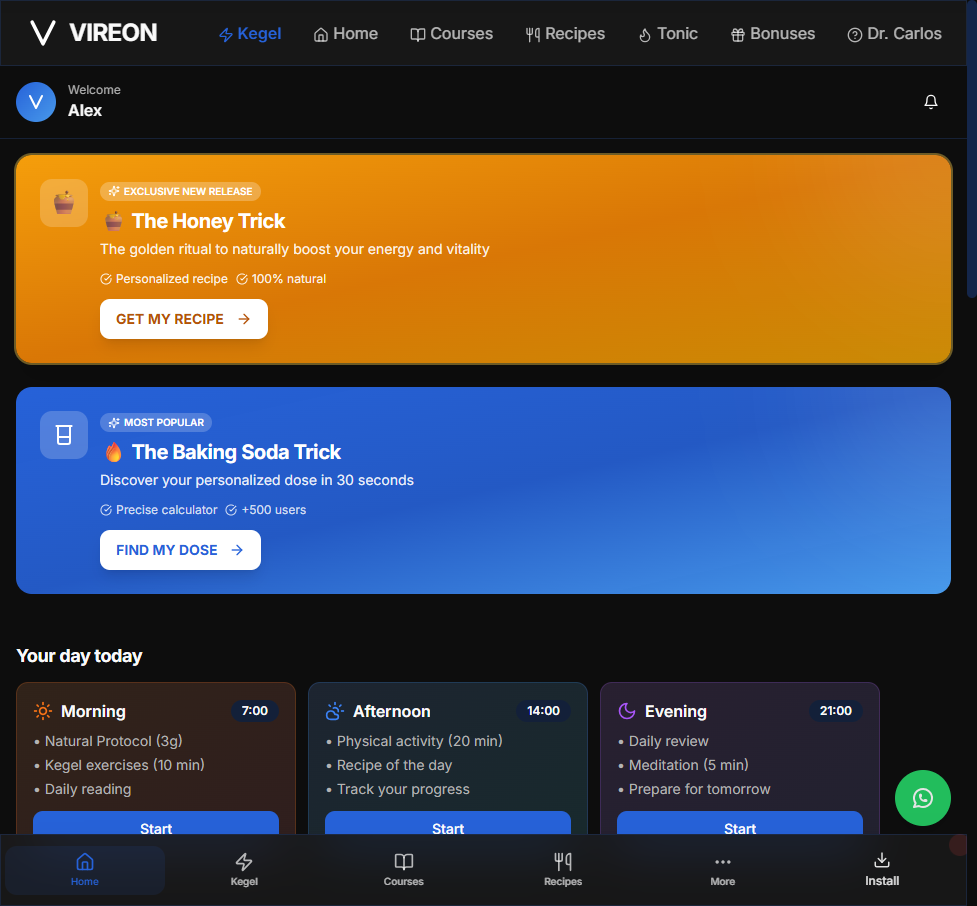

# Mapa do Funil — Vireon Protocol (verificado em 10/11/2026)

Documento de referência com todos os links, ordem real do fluxo, credenciais e pontos de atenção.
**Todos os links foram abertos e validados** — o fluxo completo foi percorrido de ponta a ponta.

---

## 1. Funil principal (quiz)

```text
https://vireonprotocols.com/esquizz
```

### VSL — já existe um slot reservado, com placeholder

O funil **já tem dois slots de VSL** implementados, ambos com player VTurb (ConverteAI) embutido e configurado:

| Slot | Etapa | Player VTurb (idVideo) | Comportamento |
| --- | --- | --- | --- |
| 1 | `/esquizz/e11` — logo após a etapa 10 | `6ae79455e4c5ed03a5af2021` | Botão `Continue` libera após **75 s** |
| 2 | `/esquizz/e23` — oferta final (junto ao pitch) | `6ae7944f9deaf4fa48eb2b95` | Player exibido no topo, sem delay |

- Conta VTurb: `636faf3f-12ee-4657-8b11-2f0f19150575`
- Aspect ratio configurado: **133,33 %** (vertical 3:4, formato 9:12)
- Thumbnails e `player.js` de ambos os vídeos respondem **200** — estão ativos.
- Como os players já estão no lugar, **basta subir o vídeo novo no painel VTurb** e trocar o `idVideo` (ou substituir o vídeo do mesmo ID). Não é preciso mexer no layout.


---

## 2. Upsells

```text
https://vireon-protocol-ln.vercel.app/up1prospusa   ->  Acelerador Clínico (7 dias) ...... US$ 50,53
https://vireon-protocol-ln.vercel.app/up2prospusa   ->  Manual del Actor ................. US$ 55,18
https://vireon-protocol-ln.vercel.app/up3prospusa   ->  Progressive Growth Method (+7 cm) US$ 64,83
https://vireon-protocol-ln.vercel.app/thanks        ->  Página de obrigado
```

Ordem real de navegação (confirmada clicando em "No thanks" em sequência):

```text
up1prospusa  ->  up2prospusa  ->  up3prospusa  ->  /thanks
```

Cada upsell aponta para **seu próprio checkout** (PerfectPay/CenterPag) e o botão de recusa avança direto para o próximo upsell — não há fricção.

| Upsell | Checkout (PerfectPay) |
| --- | --- |
| UP1 | `https://go.centerpag.com/PPU38CQH9E0?upsell=true` |
| UP2 | `https://go.centerpag.com/PPU38CQH9EA?upsell=true` |
| UP3 | `https://go.centerpag.com/PPU38CQH9E5?upsell=true` |







---

## 3. Checkout do produto principal

O quiz não leva direto ao upsell: ele entrega a oferta final (`/esquizz/e23`) com dois planos, e cada plano abre um checkout com o upsell 1 já anexado.

| Plano | Preço | Checkout |
| --- | --- | --- |
| Vireon Complete (+8 bônus) | US$ 23 | `https://go.centerpag.com/PPU38CQHH79` |
| Vireon Essential | US$ 14,90 | `https://go.centerpag.com/PPU38CQHH7A` |

Ambos os checkouts estão sob o título de produto **"Vireontrick 2.0"** no PerfectPay.



---

## 4. Página de obrigado

```text
https://vireon-protocol-ln.vercel.app/thanks
```

- Preserva UTMs do funil automaticamente (`?utm_source=...&utm_medium=...` etc.).
- O botão "Access now" aponta para `https://vireonprotocols.com/login`.
- Contém FAQ de suporte, aviso de reembolso em 30 dias e orientação anti-disputa.



---

## 5. Área do admin

```text
https://vireon-max.vercel.app/admin/login
```

| Campo | Valor |
| --- | --- |
| E-mail | `admin@vireonmax.local` |
| Senha | `Vireon-Admin-Demo-19` |

- Login validado: redireciona para `/admin` com sessão ativa (perfil "Avery · Administrador").
- Seções disponíveis: Início, Pessoas, Convites, Conteúdo, Avisos, Ajustes.
- "Pessoas" permite suspender/reativar acesso; "Convites" gera link de uso único; "Conteúdo" edita programas, alimentos, receitas, exercícios e artigos.
- O painel avisa que as contas de demonstração ainda estão ativas (4 contas, 2 ativas, 1 suspensa) e devem ser removidas em Ajustes antes de produção.



---

## 6. Área do usuário

Duas áreas distintas convivem no projeto:

### 6.1 App de acompanhamento (`vireon-max`)

```text
https://vireon-max.vercel.app/login
```

| Campo | Valor |
| --- | --- |
| E-mail | `alex@vireonmax.local` |
| Senha | `Vireon-Alex-Demo-19` |

- Login validado: abre `/app` com o perfil "Alex", programa "30-Day Wellness Journey" no dia 13/30 e histórico de demonstração.
- O app é **login por e-mail, sem senha** ("Enter any email to open the app. No password.") — a senha acima serve como referência, mas o campo de senha não é exigido.



### 6.2 Área de membros do produto (`vireonprotocols.com`)

```text
https://vireonprotocols.com/login
```

- Acessada pelo botão "Access now" da página de obrigado.
- Também é **somente e-mail, sem senha**.
- Conteúdo validado: receitas (Honey Trick / Baking Soda Trick), Kegel, cursos, bônus e calculadora de dose.



---

## 7. Bloco de copiar rápido

```text
FUNIL:      https://vireonprotocols.com/esquizz
UP1:        https://vireon-protocol-ln.vercel.app/up1prospusa
UP2:        https://vireon-protocol-ln.vercel.app/up2prospusa
UP3:        https://vireon-protocol-ln.vercel.app/up3prospusa
OBRIGADO:   https://vireon-protocol-ln.vercel.app/thanks
CHECKOUT A: https://go.centerpag.com/PPU38CQHH79   (Complete US$ 23)
CHECKOUT B: https://go.centerpag.com/PPU38CQHH7A   (Essential US$ 14,90)
ADMIN:      https://vireon-max.vercel.app/admin/login | admin@vireonmax.local | Vireon-Admin-Demo-19
USUARIO:    https://vireon-max.vercel.app/login | alex@vireonmax.local | Vireon-Alex-Demo-19
MEMBROS:    https://vireonprotocols.com/login
VSL:        slot pronto em /esquizz/e11 (75 s) e /esquizz/e23 — só trocar o vídeo no VTurb
```

---

## 8. Pontos de atenção

1. **Domínio do funil x domínio dos upsells** — o quiz está em `vireonprotocols.com`, mas os upsells e a página de obrigado ficam em `vireon-protocol-ln.vercel.app`. Quem clica no upsell sai do domínio principal. Vale mover os upsells para um subdomínio do domínio raiz (ex.: `up.vireonprotocols.com`) para não perder marca nem cookie.
2. **Contas de demonstração** — o admin sinaliza 4 contas demo ainda presentes; remover em Ajustes antes de liberar tráfego real.
3. **Idioma misto** — quiz e página de obrigado em inglês, upsells em espanhol, admin em português. Se o tráfego for de um só idioma, uniformizar.
4. **Preços divergentes** — a oferta final anuncia "US$ 23" e "US$ 14,90", mas o checkout processa `24,725` e `16,0175`. Conferir se o acréscimo é taxa de câmbio/I.O.F. e se o número exibido bate com o cobrado.
5. **Upsell 3 sem segunda saída** — os dois botões ("sim" e "não") levam ao mesmo checkout `PPU38CQH9E5`. Isso na prática torna o UP3 obrigatório na navegação; se a intenção for opcional, ajustar o link de recusa direto para `/thanks`.
6. **Área do usuário sem senha** — em `vireonprotocols.com/login` qualquer e-mail entra. Para demo é prático; para produção com tráfego pago, convém exigir o link mágico/convite.
